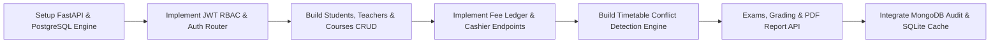

# Skyline Learning Center (SLC Academy)
## Comprehensive Project Execution Plan & Technical Specification

> **Target Platforms:** Android Mobile & iPad / Tablet (Responsive Mobile-First Architecture)  
> **Current Status:** Phase 1 Complete (Full-featured Frontend Admin Application with Mock Data, Strict Validation & PDF Engine)  
> **Next Milestone:** Phase 2 (FastAPI REST Backend, PostgreSQL Relational DB, SQLite Cache, JWT Auth & MongoDB Atlas)  
> **Color Scheme:** Primary Coral/Red (`#FA4338`), Dark Navy (`#1E202B`), Soft Warm White Canvas (`#F8F9FD`), Emerald Green (`#10B981`)

---

## 1. System Vision & Architecture

Skyline Learning Center (SLC Academy) is an enterprise-grade academic management system designed for iPads, Android tablets, and mobile smartphones. It unifies student admissions, faculty course assignments, academic classrooms, fee collection & billing, conflict-free lecture scheduling, and examination grading into an intuitive, responsive application.

```mermaid
graph TD
    subgraph Client Application [React.js Frontend (Vite + Tailwind CSS)]
        Auth[Admin JWT Authentication]
        UI[Responsive Mobile/Tablet/Desktop Interface]
        BottomNav[Mobile 4-Tab Bottom Bar]
        Drawer[Top-Right 3-Bar Navigation Drawer]
        PdfEngine[High-Resolution A4 PDF Viewer & Generator]
        ZoomEngine[Click-to-Zoom Profile Photo Modal]
        AlertEngine[Custom Validation & Alert Modal System]
    end

    subgraph Backend Services [Phase 2: FastAPI Microservice]
        API[FastAPI Asynchronous Gateway]
        RBAC[Role-Based Access Control]
        ConflictEngine[Timetable Conflict Detection Service]
        ImgProcessor[Pillow 100KB Image Validator & Compressor]
    end

    subgraph Data & Storage Layer [Databases]
        Postgres[(PostgreSQL: Core Academic & Fee Relational DB)]
        Mongo[(MongoDB Atlas: Audit Trails & Report Snapshots)]
        SqliteCache[(SQLite / IndexedDB Local Cache)]
    end

    UI --> Auth
    UI --> BottomNav
    UI --> Drawer
    UI --> PdfEngine
    UI --> ZoomEngine
    UI --> AlertEngine

    Auth -.-> API
    API --> RBAC
    API --> ConflictEngine
    API --> ImgProcessor
    API --> Postgres
    API --> Mongo
    API --> SqliteCache
```

---

## 2. Updated Phase 1 Frontend Deliverables (Completed)

### 2.1 Role & Access Model
* **Current Implementation:** Single dedicated **Admin** portal.
* **Authentication:** Secure login (`admin@slc.edu.pk` / `admin123`) with persistent session state, logout, and profile pill.
* **Prepared Role Structure:** DB and state ready for `TEACHER` and `STUDENT` accounts in Phase 2 (restricted to password updates only).

### 2.2 Mobile-First Navigation System
* **Mobile Viewports (< 768px):** Exactly **4 primary tabs** on the bottom navigation bar:
  1. **Dashboard:** Key metrics, quick actions, today's lecture schedule, and upcoming examinations.
  2. **Courses:** Academic course catalog with class track badges, assigned teachers, and base fees.
  3. **Fee:** Tuition register, collections, 3-column bank chalan generator, and verified payment receipts.
  4. **Timetable:** Interactive lecture scheduler with automated conflict detection.
* **Top Header & Drawer:**
  - Header brand pill with animated indicator.
  - Top-right Profile Pill displaying admin avatar and credentials.
  - Top-right 3-bar hamburger button toggling a slide-out drawer containing all modules: Dashboard, Students, Teachers, Courses, Classrooms, Fee, Timetable, Exams, and System Settings.

### 2.3 Strict Validation & Custom Alert Box
* Replaced native browser alerts with custom animated `CustomAlertModal` (Success, Error, Warning, Confirmation).
* **Profile Photo Limits:** Strict **100 KB** limit validation on student and teacher photos with size feedback and file inspection.
* **Image Zoom Modal:** Student and teacher profile pictures are displayed as small compact icons (`w-11 h-11 rounded-full object-cover`). Clicking any photo opens a high-resolution centered popup with a close button (`✕`) and metadata badge.

### 2.4 Academic Modules & Business Logic
1. **Students Directory:**
   - Enrolled courses selection, roll number generation, guardian details, and fee linkage.
   - Direct button to generate individual **Detailed Marks Certificate (DMC) / Mark Sheet** PDF.
2. **Teachers Directory:**
   - Specialization, qualifications, contact info, and assigned courses.
3. **Courses & Classes:**
   - Course code, course title, class name (e.g. `O-Levels`, `A-Levels`), and optional section name.
   - Removed obsolete category and duration fields.
   - Direct teacher assignment.
4. **Classroom Management (CRUD):**
   - Manage lecture halls, classrooms, science laboratories, and computer labs with capacity, floor, and building records.
5. **Conflict-Free Timetable Scheduler:**
   - Instructor is automatically assigned from the course configuration.
   - Real-time conflict engine: Blocks overlapping slots for the same instructor or same classroom.
   - In-page **Weekly Master Timetable Report (PDF)** button.
6. **Fee Management & Invoicing:**
   - Admin enters fee manually with course-based calculations.
   - **3-Column Fee Chalan (A4 Landscape):** Features Bank Copy, Academy Copy, and Student Copy.
   - **Official Fee Receipt (A4 Portrait):** Issued upon payment / clearance (`balance === 0`), complete with transaction serial, ledger verification, itemized course list, rules, and official signature/stamp block.
7. **Exams & Testing:**
   - Exam scheduling, total marks, passing marks, venue, and invigilator assignment.
   - In-page **Exam Schedule Date Sheet (PDF)** generator.
   - Marks recording and grade computation (A*, A, B, C, D, F).

### 2.5 Responsive A4 PDF Engine & Mobile Viewer
* **Dynamic Scaling:** `PdfViewerModal` auto-detects device viewport. On mobile phones, it activates **Fit Screen** mode, scaling the entire A4 sheet so that 100% of the document is visible without horizontal overflow.
* **Zoom Toolbar:** Includes `Fit Screen`, `100% Actual`, and `+` / `-` zoom controls.
* **Offscreen Sandbox Export:** `pdfGenerator.js` renders cloned nodes in an isolated offscreen container at exact standard A4 dimensions (`794px` portrait, `1123px` landscape), completely eliminating scroll clipping and distortion.

---

## 3. Technology Stack

| Layer | Technology | Specification & Role |
| :--- | :--- | :--- |
| **Frontend UI** | React 18 + Vite | Single Page Application with optimized bundle splitting |
| **Styling** | Tailwind CSS 3 | Coral/Navy color system, custom scrollbars, backdrop blur |
| **Icons** | Lucide React | Consistent vector iconography |
| **PDF Generation** | jsPDF + html2canvas | High-fidelity A4 document rasterization and vector PDF creation |
| **Backend (Phase 2)** | FastAPI (Python 3.11+) | Async REST API with Pydantic v2 schemas and auto OpenAPI docs |
| **Primary Database** | PostgreSQL | Relational schema with foreign keys and ACID transactions |
| **Document Store** | MongoDB Atlas | Audit trails, administrative logs, and report snapshots |
| **Local Cache** | SQLite / aiosqlite | Sub-millisecond lookup cache for timetables and course catalogs |
| **Auth** | JWT + Passlib (Bcrypt) | Role-Based Access Control (`ADMIN`, `TEACHER`, `STUDENT`) |

---

## 4. Phase 2 Backend Implementation Roadmap



### Detailed Phase 2 Milestones:
1. **Database Schema & Migrations:**
   - Configure SQLAlchemy 2.0 ORM models and Alembic migration scripts.
   - Tables: `users`, `students`, `teachers`, `courses`, `classrooms`, `enrollments`, `fee_records`, `fee_payments`, `timetable_slots`, `exams`, `exam_marks`.
2. **Authentication & Password Self-Service:**
   - JWT tokens with 24-hour expiration.
   - Endpoint for Students and Teachers to update their own password only (`/api/v1/auth/change-password`).
   - Admin restriction for all other profile attributes.
3. **Pillow Media Pipeline:**
   - Validate image uploads strictly at `<=` 100 KB.
   - Convert images to optimized WebP format with standard 400x400 avatars.
4. **Backend Report Generation:**
   - Server-side PDF generation endpoints as an alternative to client-side canvas rendering.
5. **Mobile Packaging:**
   - Capacitor configuration to bundle the React frontend into an Android APK and iPad app.
