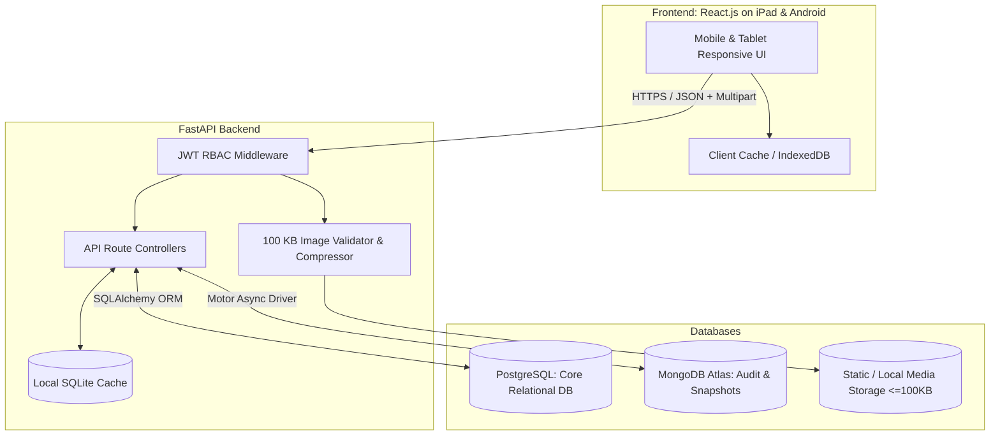
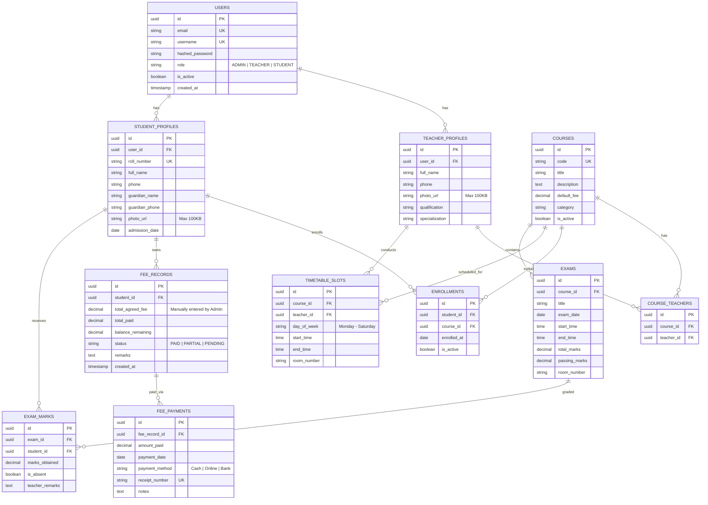
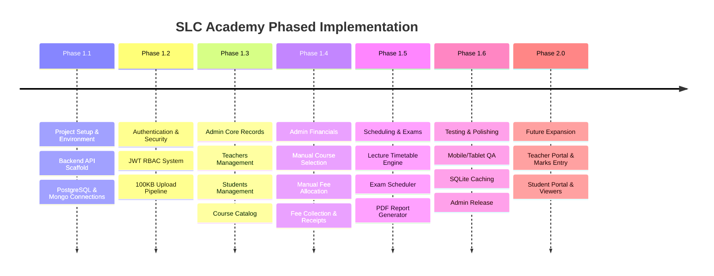

# Skyline Learning Center (SLC Academy)
## Comprehensive Project Execution Plan

> **Target Platforms:** Android Mobile & iPad / Tablet (Responsive Mobile-First Architecture)  
> **Initial Scope:** Phase 1 – Admin-Only System (with full multi-role DB & API schema prepared for Phase 2: Teachers & Students)  
> **Theme Reference:** Modern Crimson-Coral & Warm White UI (inspired by design mockup)

---

## 1. Executive Summary & Design System

SLC Academy is a role-based educational academy management application. It streamlines student admissions, teacher allocations, course catalogs, manual fee assignments, lecture timetabling, and examination grading.

### 1.1 Color Palette & UI Tokens (Extracted from Design Reference)
* **Primary Brand Coral/Red:** `#FA4338` / `#FF4742`
* **Primary Gradient:** `linear-gradient(135deg, #FF6B60 0%, #FA4338 100%)`
* **Primary Dark Navy (Text & Badges):** `#1E202B` / `#2D3142`
* **App Background:** `#F8F9FD` (Soft warm grayish-white)
* **Surface / Card Background:** `#FFFFFF` (20px–24px rounded corners, smooth elevation shadows: `0 10px 30px rgba(0, 0, 0, 0.05)`)
* **Secondary / Muted Gray:** `#8E92A4`
* **Accent Gold / Amber (Ratings & Pending fees):** `#FFB800` / `#F59E0B`
* **Success Emerald Green (Paid / Passed):** `#10B981`
* **Button Style:** Pill-shaped (`border-radius: 9999px`), bold typography, crisp active press animations.

### 1.2 Responsive Screen Adaptations
* **Mobile (Android - 360px to 480px width):** Single column, bottom navigation bar, floating action buttons, swipeable cards, touch-optimized dialogs.
* **Tablet (iPad / Android Tablet - 768px to 1024px+ width):** Collapsible dual-column sidebar layout, master-detail views for student/fee lists, wider timetable grids, split modal sheets.

---

## 2. Technology Stack & Architectural Division

| Layer | Technology | Purpose & Responsibility |
| :--- | :--- | :--- |
| **Frontend** | React.js (Vite + Tailwind CSS + Lucide Icons) | Cross-platform responsive mobile/tablet web UI. Prepared for Capacitor wrapper for native Android APK & iPad builds. |
| **Backend API** | FastAPI (Python 3.10+) | High-performance asynchronous REST API, auto OpenAPI/Swagger docs, Pydantic v2 schemas. |
| **Relational Database** | PostgreSQL | Primary source of truth for structured transactional data: Users, Roles, Courses, Enrollments, Fees, Timetables, Exams, and Marks. |
| **Document Database** | MongoDB Atlas | Audit trails, administrative activity logs, notification archives, and generated report snapshot cache. |
| **Local Cache** | SQLite Cache (`aiosqlite` / client IndexedDB-SQLite) | High-speed local cache for timetable slots, offline-capable lookup tables, and query response caching. |
| **Authentication** | JWT (JSON Web Tokens) with Passlib & Bcrypt | Bearer tokens with strict RBAC (`ADMIN`, `TEACHER`, `STUDENT`). |
| **Media Handling** | Pillow (Python) + Client-side canvas compression | Strict profile photo validation: maximum **100 KB**, auto-resize to 400x400 JPG/WebP. |
| **Reporting Engine** | ReportLab / WeasyPrint (Backend) + jsPDF (Frontend) | Print-ready Timetable PDF and Examination Schedule PDF generation. |

---

## 3. Database Architecture & Schema Design

### 3.1 PostgreSQL Relational Model

### 3.2 MongoDB Atlas Collections
* `admin_audit_logs`: Tracking every admin action (student registration, fee overrides, course assignments, timetable modifications) with timestamp, admin ID, IP, and payload snapshot.
* `report_snapshots`: Pre-rendered JSON metadata and historical versions of generated Timetable and Exam Schedule reports for instant re-download.
* `system_notifications`: System alerts, announcements, and fee payment receipts.

### 3.3 SQLite Cache Schema
* `cached_timetables`: Fast key-value table (`key: teacher_id / student_id / day`, `value: JSON string`, `expires_at: timestamp`).
* `cached_reports`: Offline-first cached report metadata.

---

## 4. Business Rules & Access Control (RBAC)

1. **Strict Admin Supremacy:**
   * Admin has exclusive rights to create, edit, deactivate, or delete Students, Teachers, Courses, Fees, Enrollments, Exams, and Timetable Slots.
   * Admin manually assigns courses to teachers.
   * During student creation, Admin manually selects courses and manually enters the total fee.
2. **Teacher & Student Self-Service Restriction:**
   * Students and Teachers **can only change their own passwords**.
   * Personal profile fields (name, phone, photo, enrolled courses, etc.) are strictly read-only for them. They must contact Admin to request changes.
3. **Profile Picture Constraint:**
   * Hard limit: **100 KB**.
   * Client-side pre-compression (HTML Canvas/WebP compressor) warns if > 100 KB.
   * Server-side FastAPI upload validator checks byte length <= 102,400 bytes, validates image mime-type and re-encodes via Pillow to eliminate malicious code.
4. **Grading & Timetable Permissions:**
   * Teachers can only view schedules and enter marks for courses assigned to them.
   * Students can view their timetable, exam schedule, obtained marks, and fee payment balance/history.

---

## 5. Detailed Project Execution Roadmap

### Phase 1: Admin-Only System (Immediate Priority)

#### Milestone 1.1 — Architecture & Project Scaffolding
- [ ] Initialize repository structure (`/backend` for FastAPI, `/frontend` for React mobile-first SPA).
- [ ] Setup PostgreSQL with Alembic migrations.
- [ ] Setup MongoDB Atlas connection via Motor for audit logging.
- [ ] Setup SQLite caching layer for high-speed queries.
- [ ] Configure Vite + Tailwind CSS with the design system tokens (`#FA4338` primary coral, card shadows, pill buttons).

#### Milestone 1.2 — Authentication & Base Services
- [ ] Implement JWT Auth flow (`/api/v1/auth/login`, `/api/v1/auth/refresh`, `/api/v1/auth/me`).
- [ ] Enforce Role-Based Access Control decorator (`@require_roles(Role.ADMIN)`).
- [ ] Build 100 KB profile picture upload utility:
  - Client pre-resizer + file size checker.
  - Server validation (Pydantic / FastAPI `UploadFile`, byte size `<= 102400`, Pillow verification).

#### Milestone 1.3 — Admin Teacher & Course Management
- [ ] **Course Catalog:** CRUD for courses (Course Code, Name, Base Fee, Description).
- [ ] **Teacher Management:**
  - Create Teacher (Name, Phone, Email, Photo <=100KB, Qualification, Auto-generated default password).
  - Assign one or multiple courses to a Teacher.
  - Update & view teacher profiles and assigned workload.

#### Milestone 1.4 — Admin Student Management & Manual Fee Allocation
- [ ] **Student Admission Form:**
  - Enter student details, guardian info, roll number, and 100 KB photo.
  - **Manual Course Selection:** Checkbox/multi-select of available courses.
  - **Manual Fee Entry:** Admin enters custom negotiated/total fee for this student.
  - Automatically calculate balance (`balance = total_fee - paid_amount`).
- [ ] **Fee Management & Cashier:**
  - View list of students with Fee Status (`Paid`, `Partial`, `Pending`).
  - Collect fee modal: record payment installment, payment mode (Cash/Transfer), date, and remarks.
  - Generate downloadable/printable digital fee receipt.

#### Milestone 1.5 — Timetable & Exam Management with PDF Reports
- [ ] **Timetable Scheduling:**
  - Visual timetable builder (Day, Start Time, End Time, Course, Teacher, Room).
  - Conflict detection algorithm (prevents double-booking teachers or rooms).
  - **Admin Timetable PDF Export:** Formatted daily/weekly master timetable report.
- [ ] **Exam Management:**
  - Schedule exams (Course, Title, Date, Timing, Total Marks, Room).
  - **Admin Exam Schedule PDF Export:** Printable schedule for notice boards / students.
  - Admin marks viewing & override interface.

#### Milestone 1.6 — Admin Dashboard, Mobile/Tablet Optimization & Polish
- [ ] Admin Dashboard Overview Cards (Total Students, Active Teachers, Pending Fees, Today's Lectures).
- [ ] Optimize responsiveness for Android phones (portrait) and iPad/tablets (landscape/portrait split view).
- [ ] Implement SQLite query caching for timetable and course queries.
- [ ] Log all critical operations to MongoDB Atlas.

---

### Phase 2: Teacher & Student Portals (Future Extension)

#### Milestone 2.1 — Teacher Portal
- [ ] Teacher Login & First-time password change prompt.
- [ ] "My Assigned Courses" screen.
- [ ] "My Lecture Timetable" view (daily & weekly agenda).
- [ ] "Exam Marks Entry" module: select exam, view enrolled students, enter marks/absent flag, submit to admin.
- [ ] Self-service: **Password change only**. All other profile edits disabled with "Contact Admin" banner.

#### Milestone 2.2 — Student Portal
- [ ] Student Login with Roll Number / Email.
- [ ] "My Daily Schedule" timetable viewer with real-time indicator for active/next class.
- [ ] "My Exams & Tests" view: upcoming exam dates, room numbers, and published marks.
- [ ] "Fee Status": View total fee, amount paid, remaining balance, and past payment receipts.
- [ ] Self-service: **Password change only**.

---

## 6. API Route Specification (Phase 1 Focused)

### Auth (`/api/v1/auth`)
* `POST /login` – Authenticate with username/email & password, return JWT tokens and role.
* `POST /change-password` – Allows any logged-in user (Admin, Teacher, Student) to update password.
* `GET /me` – Retrieve profile and permissions of currently authenticated user.

### Teachers (`/api/v1/admin/teachers`)
* `GET /` – List teachers (search, filter by course).
* `POST /` – Create teacher with photo (multipart/form-data, `<= 100 KB`).
* `GET /{id}` – View teacher details and assigned courses.
* `PUT /{id}` – Update teacher details.
* `POST /{id}/assign-courses` – Assign/reassign courses to teacher.

### Students (`/api/v1/admin/students`)
* `GET /` – List students (search by roll number, name, fee status).
* `POST /` – Register student with 100 KB photo, manual course selection, and manual fee entry.
* `GET /{id}` – View comprehensive student profile, enrolled courses, and fee history.
* `PUT /{id}` – Update student information.

### Fees (`/api/v1/admin/fees`)
* `GET /overview` – Total revenue, collected fee, and pending dues metrics.
* `GET /student/{student_id}` – Detailed fee breakdown for a student.
* `POST /collect` – Record a new fee payment installment.
* `GET /receipt/{payment_id}` – Generate fee receipt data / PDF.

### Timetable (`/api/v1/admin/timetable`)
* `GET /` – Get master timetable slots (filtered by day, course, or teacher).
* `POST /slots` – Create new lecture slot with conflict validation.
* `DELETE /slots/{id}` – Remove lecture slot.
* `GET /report/pdf` – Generate printable Master Timetable PDF.

### Exams (`/api/v1/admin/exams`)
* `GET /` – List all scheduled exams.
* `POST /` – Create new exam schedule.
* `GET /report/pdf` – Generate printable Exam Schedule PDF.
* `GET /{id}/marks` – View entered marks for an exam.

---

## 7. Quality Assurance, Security & Performance Checklist

1. **Security & RBAC Enforcement:**
   - [ ] Passwords hashed with `bcrypt` (minimum 12 rounds).
   - [ ] Strict CORS policy configured for mobile web / Capacitor origins.
   - [ ] Route level dependency checks ensuring non-admins cannot access `/api/v1/admin/*`.
2. **File Upload Security:**
   - [ ] Magic byte inspection to verify uploaded image is authentic JPEG/PNG/WebP.
   - [ ] Content length check <= 102,400 bytes (100 KB limit strictly upheld).
   - [ ] Strip EXIF metadata to protect user privacy.
3. **Responsive UI/UX Standards:**
   - [ ] Tested on 375px (Android phone width) and 820px/1024px (iPad portrait and landscape).
   - [ ] Minimum 48px touch targets for buttons and interactive controls.
   - [ ] Custom branded color scheme with high contrast accessibility (WCAG AA compliant).
4. **Data Integrity:**
   - [ ] Foreign key constraints across PostgreSQL tables.
   - [ ] Atomic database transactions during student creation (User + StudentProfile + Enrollments + FeeRecord created in a single ACID transaction).
   - [ ] MongoDB audit logs capturing every manual fee alteration and course override.

---

*Prepared for Skyline Learning Center (SLC Academy) by Antigravity Engineering.*
