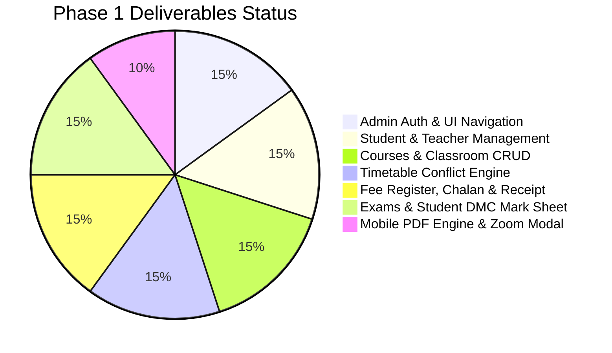

# Skyline Learning Center (SLC Academy)
## Current Progress & Status Report

> **Last Updated:** November 06, 2026  
> **Current Phase:** Phase 1 (Frontend Admin Application & PDF Generation Engine) — **Complete & Verified**  
> **Development Server:** Running on `http://localhost:5174/` (Vite v6.4.5)  
> **Build Status:** Passing with 0 errors (`✓ built in 18.97s`)

---

## 1. Summary of Completed Deliverables

All user requests and core architectural requirements for Phase 1 have been implemented, tested, and verified.

---

## 2. Detailed Feature Breakdown

### 2.1 Authentication & Navigation System
* **Admin-Only Scope:** Single Admin authentication (`admin@slc.edu.pk` / `admin123`) with persistent session management.
* **Mobile-First Navigation:**
  * **Mobile Screen (< 768px):** Exactly **4 bottom navigation tabs**:
    1. **Dashboard**
    2. **Courses**
    3. **Fee**
    4. **Timetable**
  * **Top-Right 3-Bar Hamburger Drawer:** Toggles a slide-out drawer containing all modules: Dashboard, Students, Teachers, Courses, Classrooms, Fee, Timetable, Exams, and Admin Profile.
  * **Top-Right Profile Pill:** Displays administrator avatar, username, and role.
  * **Desktop / iPad Navigation:** Full top bar with active status indicators.

### 2.2 Profile Photos, Click-to-Zoom & Validation
* **Small Icon Profile Photos:** Rendered as compact rounded badges (`w-11 h-11 rounded-full object-cover border-2 border-coral-200`) across both Student and Teacher directories.
* **Click-to-Zoom Modal (`ImageZoomModal.jsx`):** Clicking on any student or teacher photo triggers a high-resolution lightbox popup featuring a close button (`✕`) and file size badge.
* **Strict 100 KB Photo Validation:** Both Student Admission and Teacher Registration forms enforce a strict 100 KB limit, displaying a custom error dialog if violated.
* **Custom Alert & Error Box (`CustomAlertModal.jsx`):** Replaced native browser alerts with custom animated modals for alerts, confirmations, and validation errors.

### 2.3 Courses & Classroom Management
* **Course Structure (`CoursesView.jsx`):**
  * Displays Course Name, Course Code, Class Name (e.g. `O-Levels`, `A-Levels`), and optional Section Name.
  * Removed category and duration fields.
  * Auto-links assigned instructors.
* **Classrooms CRUD (`ClassroomsView.jsx`):**
  * Full create, read, update, delete functionality for classrooms, lecture halls, and laboratories.
  * Tracks room capacity, building, floor, and room type.

### 2.4 Conflict-Free Timetable Scheduler
* **Automated Instructor Assignment:** Instructors are automatically selected based on the assigned course instructor (preventing manual mismatch).
* **Collision-Detection Engine:** Prevents assigning the same instructor or same classroom to overlapping lecture slots on any day.
* **Weekly Master Timetable Report (PDF):** In-page generator exporting the complete weekly lecture schedule.

### 2.5 Fee Management, 3-Column Chalan & Official Receipt
* **Course-Based Fee Tracking:** Base fees calculate automatically from enrolled courses; admin can enter manual agreed fees and discounts.
* **3-Column Landscape Bank Fee Chalan (PDF):**
  * Formatted in 3 distinct columns on A4 Landscape: **Bank Copy**, **Academy Copy**, and **Student Copy**.
  * Contains bank account numbers, chalan numbers, student metadata, fee breakdown, and cashier signature boxes.
* **Official Fee Payment Receipt (A4 Portrait):**
  * Automatically issued when dues are cleared (`balance === 0`) or upon cashier payment collection.
  * Formatted with academy header & NTN, verification badge, student particulars 2-column card, enrolled courses tuition breakdown table, payment summary, academy conditions, and official triple-signatures (Student, Accounts Stamp, Accounts Officer).

### 2.6 Examination & Detailed Marks Certificate (DMC)
* **Exam Management:** Admin schedules exams with total marks, passing marks, venue, and invigilator.
* **Exam Schedule Date Sheet (PDF):** Direct in-page export of the academy date sheet.
* **Detailed Marks Certificate (DMC) / Mark Sheet (PDF):**
  * Direct action on each student card in the Student Directory.
  * Computes course marks, percentages, letter grades (A*, A, B, C, D, F), overall cumulative score, and promotion status.

### 2.7 Responsive Mobile PDF Viewer & Offscreen Sandbox Export
* **Mobile Screen Fit:** `PdfViewerModal.jsx` automatically calculates the screen width and applies responsive scaling (**Fit Screen** mode). On mobile phones, the entire A4 document is 100% visible without horizontal overflow.
* **Interactive Zoom Toolbar:** Users can toggle between **Fit Screen**, **100% Actual Size** (with smooth horizontal and vertical touch scrolling), and **+ / -** zoom buttons.
* **Undistorted High-Resolution PDF Export (`pdfGenerator.js`):** Clones the document into an isolated offscreen staging sandbox at standard A4 pixel dimensions (`794px × 1123px` portrait, `1123px × 794px` landscape), completely eliminating scroll clipping and distortion in downloaded PDFs.

### 2.8 Clean Dashboard UI
* Removed the sparkle emoji (`✨`) from the **Administrator Control Panel** label for a cleaner, professional presentation.

---

## 3. Technology Stack & Packages

| Package | Version | Purpose |
| :--- | :--- | :--- |
| `react` | 18.3.1 | Core UI library |
| `react-dom` | 18.3.1 | DOM renderer |
| `vite` | 6.4.5 | Fast development server & production bundler |
| `tailwindcss` | 3.4.17 | Utility-first styling with custom theme tokens |
| `lucide-react` | 0.469.0 | Icon library |
| `jspdf` | 2.5.2 | Vector PDF document generation |
| `html2canvas` | 1.4.1 | High-resolution DOM-to-canvas rasterizer |

---

## 4. Key Files & Components

| Component / Utility | File Path | Description |
| :--- | :--- | :--- |
| **PDF Export Engine** | `frontend/src/utils/pdfGenerator.js` | Offscreen sandbox renderer & A4 PDF downloader |
| **Responsive PDF Modal** | `frontend/src/components/common/PdfViewerModal.jsx` | Mobile-responsive viewer with auto-scale & zoom |
| **Fee Receipt Document** | `frontend/src/components/fees/FeeReceiptDocument.jsx` | A4 Portrait fee receipt with courses & signatures |
| **Fee Chalan Document** | `frontend/src/components/fees/FeeChalanDocument.jsx` | 3-Column A4 Landscape bank fee chalan |
| **DMC Mark Sheet** | `frontend/src/components/students/MarkSheetDocument.jsx` | Student transcript with grades & official seal |
| **Timetable Scheduler** | `frontend/src/components/timetable/TimetableScheduleView.jsx` | Conflict-free scheduler & timetable report |
| **Exam Date Sheet** | `frontend/src/components/exams/ExamsView.jsx` | Exam schedule & date sheet report |
| **Classroom CRUD** | `frontend/src/components/classrooms/ClassroomsView.jsx` | Classroom & laboratory management |
| **Global State & Conflict** | `frontend/src/context/AppContext.jsx` | State, validation, and collision engine |
| **Mock Database** | `frontend/src/data/mockData.js` | Initial mock datasets for SLC Academy |

---

## 5. Next Steps (Phase 2: Backend & Multi-Role)

1. **FastAPI REST API:** Create endpoints for Auth, Students, Teachers, Courses, Classrooms, Fees, Timetables, and Exams.
2. **PostgreSQL Relational DB:** Set up SQLAlchemy 2.0 ORM schemas and Alembic database migrations.
3. **MongoDB Atlas:** Configure audit trails and generated report snapshot storage.
4. **SQLite Local Cache:** High-speed lookup cache for timetable conflict checking.
5. **Multi-Role Accounts (Teacher & Student):**
   - Provide student/teacher login with restricted permissions (password updates only; contact admin for all other changes).
6. **Mobile APK / iOS Build:** Wrap the frontend using Capacitor for native Android and iPad distribution.
